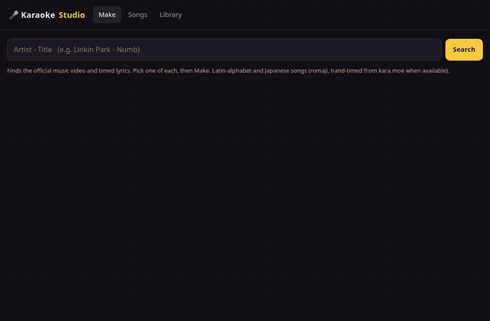

# Karaoke Studio



<sub>The video and thumbnails are blurred in this demo for copyright; in the app they show normally.</sub>

Turn an official music video into a karaoke video, with the vocals removed and the lyrics lighting up word by word, then publish it to [PiKaraoke](https://github.com/vicwomg/pikaraoke).

Type `Artist - Title`. The studio finds the music video on YouTube and the lyrics on [LRCLIB](https://lrclib.net), removes the vocals on your GPU, and times every word to the singing. You preview it in the browser, fix anything you want, and publish.

## What it does

- **Finds the right video and lyrics.** Official music videos are preferred over lyric videos, live versions, covers and dance practices. No lyrics online? Paste them from any site; if LRCLIB has a timed version, your words get its timing.
- **Times the lyrics by listening.** It finds the album recording and matches it against the video's music, so skits, scenes in the middle and cuts are found exactly. Talking keeps its sound; only the singing is removed. Backing vocals in brackets get their own line, so they can overlap the lead.
- **Fixes lyric mistakes.** An optional local AI (via [Ollama](https://ollama.com)) catches dropped or swapped words and wrong Japanese readings, and keeps a change only if it fits the singing better.
- **Lets you edit easily.** A waveform or spectrogram of the vocals with a block per line: drag, stretch, or tap **S** as each line is sung, and starts snap to where notes begin. Slow playback to 0.5×, loop a line, split or join lines. Lines the studio is unsure about are marked ⚠, and *Next line to check* walks you through them.
- **Colours singers.** Duets, groups of up to 8 named singers, and lines shared mid-way (paint the words of each singer). Pasting a Genius page with headers like `[Chorus: Name]` colours the lines for you.
- **Remakes safely.** Older songs show what a remake would improve. A remake keeps your edits, changes nothing if it finds nothing better, and can be undone.
- **Uses a second GPU.** A PC on your network can take songs when the main GPU is busy, or you can choose which GPU makes each song.

## Languages

| Language | How the lyrics are shown |
|---|---|
| English and other Latin-alphabet languages (Spanish, French, Vietnamese…) | As written |
| Japanese | Romaji with the Japanese line above it: hand-made from [kara.moe](https://kara.moe) when available, otherwise automatic and checked by listening |
| Korean | Romanized the way it's pronounced, with the Korean line above it |
| Mandarin Chinese | Pinyin with the Chinese line above it |
| Mixed (an English song with a Japanese, Korean or Chinese chorus) | Each line as above |

Cantonese and other scripts (Cyrillic, Thai…) aren't supported yet. The studio says so rather than showing wrong lyrics.

## How it works

1. [BS-RoFormer](https://github.com/nomadkaraoke/python-audio-separator) splits the vocals from the music.
2. Whisper ([stable-ts](https://github.com/jianfch/stable-ts), large-v3) transcribes the vocals, and the lyrics are matched against what was actually sung. That gives each line its place in the video, including where the video jumps.
3. The album recording is found on YouTube and matched against the video's music (librosa), giving an exact map of skits, scenes and cuts.
4. A forced aligner (torchaudio MMS) places every word. Lines that fit badly are marked for you to check.
5. The result is an `.ass` subtitle on two alternating rows, so the next line shows before it's sung.

## Requirements

- Linux with an NVIDIA GPU (about 9 GB free per song), Python 3.12, ffmpeg and Node.js.
- [PiKaraoke](https://github.com/vicwomg/pikaraoke) 1.23 or newer to publish to. The studio works on its own for previews.
- Optional: [Ollama](https://ollama.com) for the AI lyrics and romaji checks.

## Setup

```sh
git clone https://github.com/alainator/karaoke-studio && cd karaoke-studio
python3.12 -m venv venv
venv/bin/pip install torch torchaudio --index-url https://download.pytorch.org/whl/cu128   # match your driver
venv/bin/pip install -r requirements.txt
venv/bin/python -I get_renderer.py        # lyric renderer and fonts
cp .env.example .env && chmod 600 .env    # then edit it
venv/bin/python -I app.py                 # http://127.0.0.1:5570
```

The first song downloads the models (about 4 GB). `deploy/karaoke-studio.service.example` is a systemd unit.

Songs made with older versions can have their videos fixed for smooth seeking with `venv/bin/python -I deploy/reencode-videos.py`.

## A second GPU (optional)

On the other PC (Arch/CachyOS):
```sh
curl -fsSLO https://raw.githubusercontent.com/alainator/karaoke-studio/main/deploy/install-helper.sh
bash install-helper.sh <studio server IP>
```
It installs about 10 GB and prints a secret. Then, on the studio server:
```sh
venv/bin/python -I deploy/set-helper.py <PC IP> "gaming PC"   # asks for the secret
sudo systemctl restart karaoke-studio
```
The helper only accepts the studio server, and only with the secret. It updates itself from GitHub whenever the studio runs newer code.

## Security

**The studio has no login of its own**, and it can change your karaoke library. Keep it on `127.0.0.1`, or put it behind a reverse proxy that requires a login (Authentik, Authelia, oauth2-proxy…), and set `STUDIO_ORIGINS` to the address you use.

## Notes

- You're responsible for what you download and how you use it. This is meant for karaoke at home.
- LRCLIB is a free community service; please keep `STUDIO_USER_AGENT` meaningful.
- Not affiliated with PiKaraoke. The lyric renderer is [JavascriptSubtitlesOctopus](https://github.com/libass/JavascriptSubtitlesOctopus).

## License

MIT, see [LICENSE](LICENSE).
